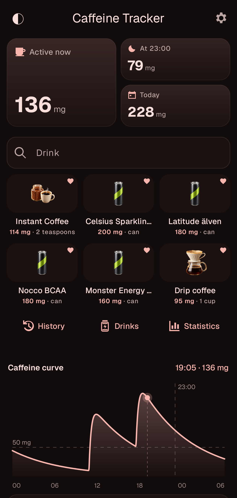
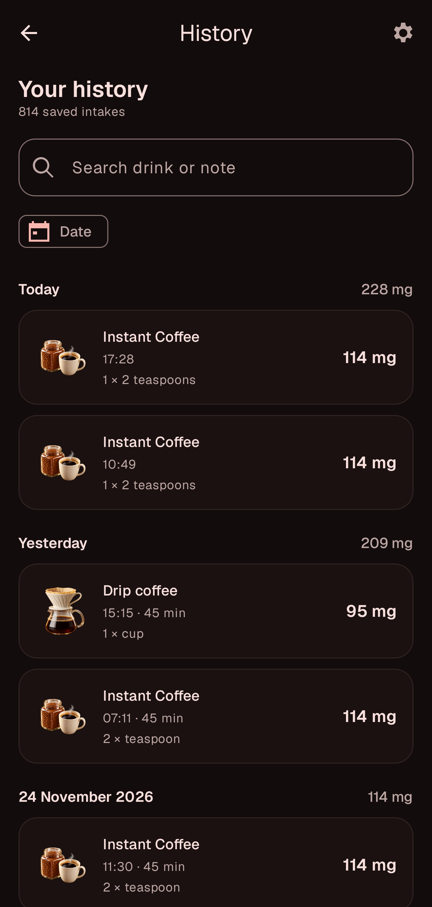
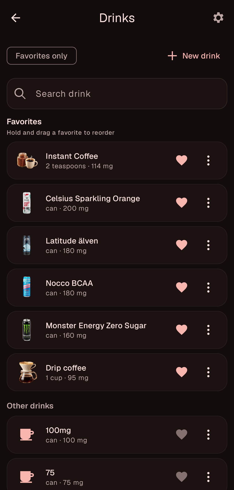
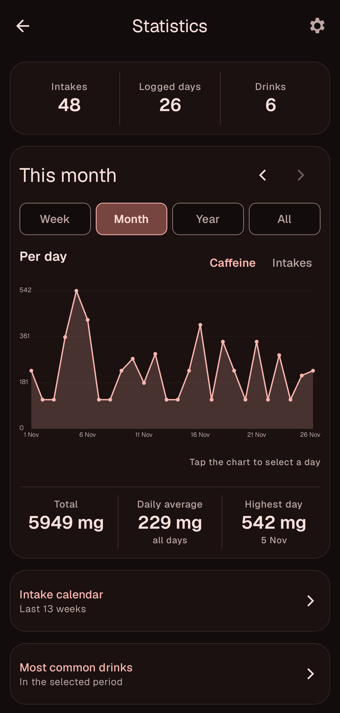
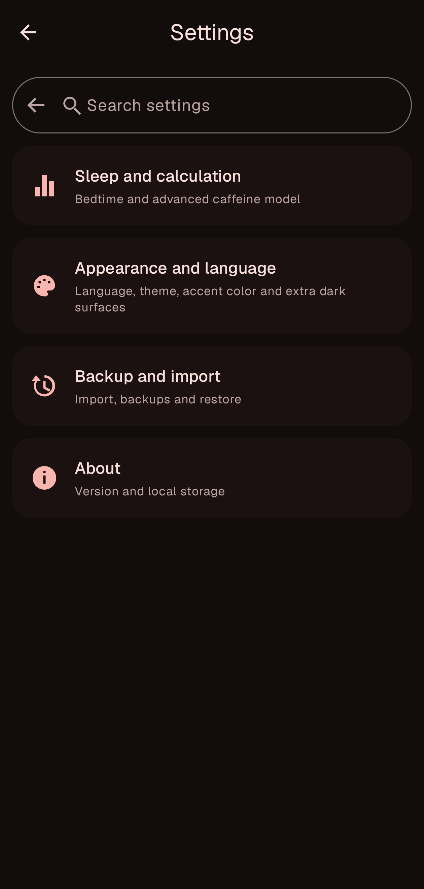
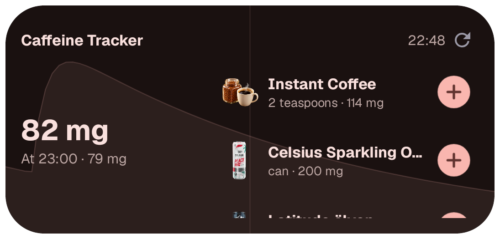

<p align="center">
  
</p>

<h1 align="center">Caffeine Tracker</h1>

<p align="center">
  A local-first Android app for logging caffeine, tracking estimated active levels across the day, and adding favourite drinks straight from a home screen widget.
</p>

<p align="center">
  Live Curve&nbsp;&nbsp;•&nbsp;&nbsp;Quick-Add Favourites&nbsp;&nbsp;•&nbsp;&nbsp;Statistics &amp; Heatmap&nbsp;&nbsp;•&nbsp;&nbsp;Home Widget&nbsp;&nbsp;•&nbsp;&nbsp;Local &amp; Drive Backups
</p>

<p align="center">
  
  
  
  
</p>

Caffeine Tracker models caffeine absorption and elimination from your logged drinks, shows estimated active caffeine right now and at bedtime, and keeps your entire history on your device with no account required.

## Screenshots

Caffeine Tracker 1.0 on a real device.

<table>
<tr><th>Home &amp; live caffeine curve</th><th>History</th></tr>
<tr><td></td><td></td></tr>
<tr><th>Drinks &amp; favourites</th><th>Statistics</th></tr>
<tr><td></td><td></td></tr>
<tr><th>Settings</th><th>Home screen widget</th></tr>
<tr><td></td><td></td></tr>
</table>

## Features

- **Live caffeine dashboard:** Estimated active caffeine now, projected level at your configured bedtime, and today's total intake at a glance.
- **Interactive 30-hour caffeine curve:** Smooth monotone curve showing absorption, peak, and elimination across the day and night, with a bedtime threshold guide, bedtime marker, and touch/drag scrubbing.
- **One-tap favourites & custom drinks:** Paged favourites grid on the home screen, searchable drink catalog with built-in drinks and custom recipes, custom portion sizes, sipping duration, absorption time, and drink icons.
- **History & fast editing:** Chronological intake history with search, date-range filtering, notes, and quick editing or deletion without losing original timestamps.
- **Statistics & intake heatmap:** Weekly, monthly, yearly, and all-time charts for caffeine (mg) and intake counts, a 13-week intake calendar heatmap, and top drinks breakdown.
- **Home screen widget:** Compact and expanded home screen widget showing active caffeine, bedtime estimate, daily total, quick-add favourite buttons, and one-tap Undo.
- **Languages & theming:** Full Swedish and English UI with canonical drink matching (switching languages never splits statistics), System/Light/Dark themes, selectable accent colours, and an Extra dark mode.
- **Import & backups:** Import history from JSON or CSV, export/restore full JSON backups with preview and pre-restore safety copies, automatic rolling local backups (with optional external folder via SAF), and optional Google Drive cloud backup with read-back verification.

## Install

Download the signed APK and matching `.sha256` file from this repository's **Releases** page. Open the APK on Android 8.0 or later and allow installation from the app you opened it with if Android asks. For ADB updates using the same signing certificate:

```sh
adb install -r Caffeine-Tracker-1.0-release.apk
```

If you previously installed a private build signed with a different certificate, export a full JSON backup in **Settings → Backup and import**, copy it somewhere outside the app, and verify that it opens. Pause automatic Drive backup on any device still running the earlier build before switching. Then uninstall the old build, install the signed release, and restore your JSON backup.

## Build from source

Install JDK 17 or 21 and Android SDK Platform 34 with Build Tools 34.0.0. Set `JAVA_HOME` and `ANDROID_HOME`, or configure the SDK in Android Studio. From a clean checkout run:

```sh
./gradlew assembleDebug testReleaseUnitTest lintRelease
```

On Windows use `.\gradlew.bat`. Gradle downloads dependencies from Google's Maven repository, Maven Central, and the Gradle Plugin Portal. The debug APK is written to `app/build/outputs/apk/debug/app-debug.apk`.

For a signed release build, supply `CAFFEINE_KEYSTORE`, `CAFFEINE_STORE_PASSWORD`, `CAFFEINE_KEY_ALIAS`, and `CAFFEINE_KEY_PASSWORD` in your environment and run:

```powershell
.\build.ps1 -Release -Checks
```

This writes the signed APK and SHA-256 checksum under `outputs/`. On other systems, run `./gradlew assembleRelease` with those environment variables set. Maintain one signing key across releases and keep the keystore and credentials outside the repository.

The visible version (`versionName`) is maintained in `app/build.gradle.kts`, while `build.ps1` automatically increments `versionCode` in `build-number.properties` on each successful packaged build (use `-NoBump` for local verification without advancing the build number).

## Backups and privacy

Intake history, favourites, custom drinks, and preferences are stored locally in SQLite. Logging, charts, statistics, and the home screen widget work completely offline without an account. JSON backups are human-readable files, so store them somewhere you trust. Restores show a preview and automatically save a local recovery copy before replacing data.

Android cloud backup is disabled for app data (`allowBackup` rules exclude cloud backup while allowing Android 12+ device-to-device transfer). For cross-device transfers, use JSON export/import or opt in to Google Drive backup.

Google Drive backup is optional and only uploads when automatic backup is enabled or when you trigger a backup manually. It verifies uploads by reading them back before pruning older copies to Drive Trash, pauses if competing uploads conflict, and leaves existing Drive files untouched if you disconnect. Uploads are protected in transit but are not end-to-end encrypted. See [docs/RELEASE_VERIFICATION.md](docs/RELEASE_VERIFICATION.md) for OAuth and release verification steps.

## Credits and source terms

Caffeine Tracker reuses UI and architecture components from Roinur's Sauce Tracker Rewrite and Book Tracker. Caffeine levels are pharmacological estimates of absorption and elimination based on your recorded doses, timings, and half-life setting. See [BASE_PROVENANCE.txt](BASE_PROVENANCE.txt), [LICENSE](LICENSE), and [THIRD_PARTY_NOTICES.md](THIRD_PARTY_NOTICES.md).
